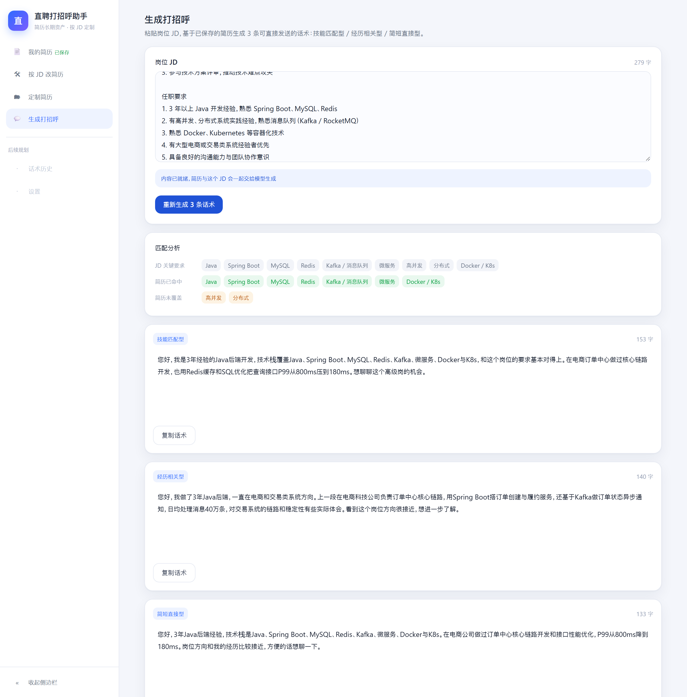
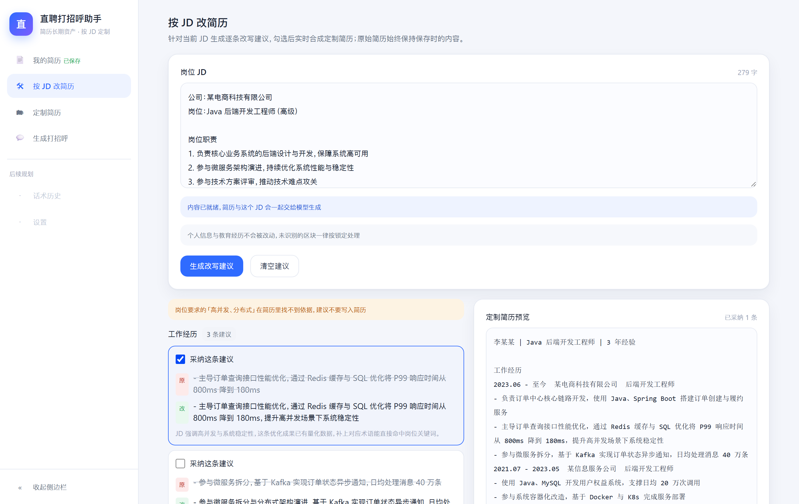
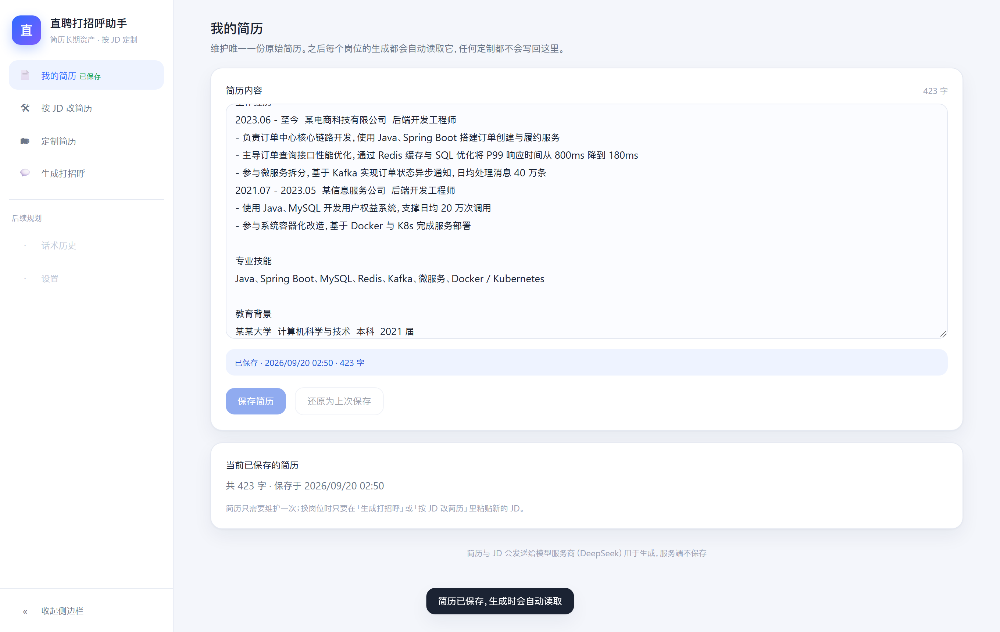
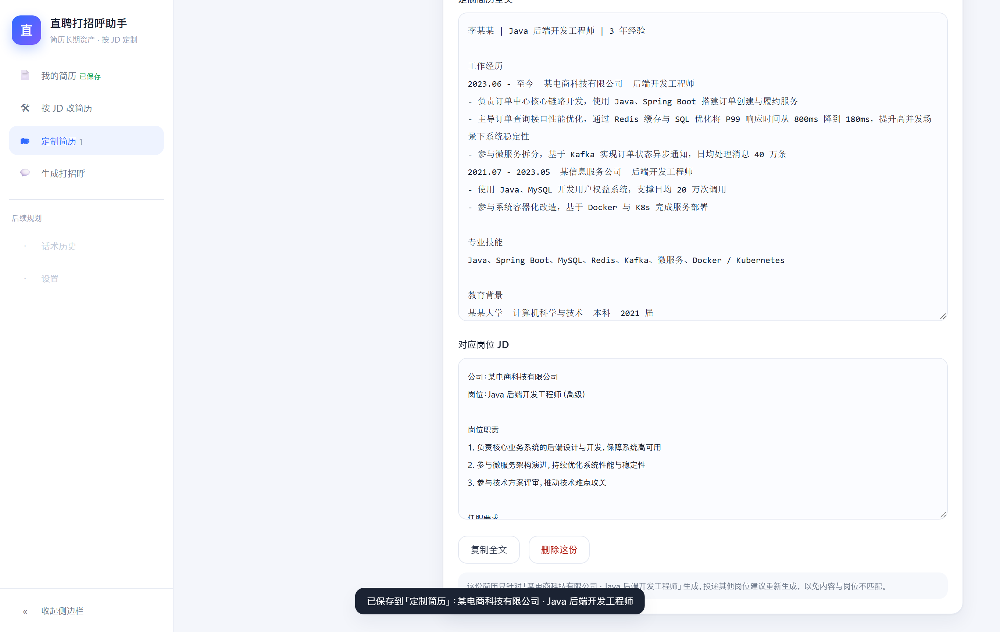

# 直聘打招呼助手

面向求职者的轻量工具：维护一份长期简历，针对具体岗位 JD 生成可直接发送的打招呼话术，以及逐条可采纳的简历改写建议。

只看一页的话，打开 [作品集_CaseStudy_V1.0.html](作品集_CaseStudy_V1.0.html)（含 66 秒主流程录屏）；只看一份文档的话，看 [docs/作品集主文档_V1.3.md](docs/作品集主文档_V1.3.md)：三分钟读完产品判断、评测体系与已知不足。

产品口径见 [直聘打招呼助手_PRD_V0.2.md](直聘打招呼助手_PRD_V0.2.md)，增量设计见四份增补：[PRD V0.3](直聘打招呼助手_PRD_V0.3_增补.md)（导入能力）、[PRD V0.4](直聘打招呼助手_PRD_V0.4_增补.md)（Word 保真导出）、[PRD V0.5](直聘打招呼助手_PRD_V0.5_增补.md)（话术历史）、[PRD V0.6](直聘打招呼助手_PRD_V0.6_增补.md)（界面布局与交互收口）；实现口径见 [docs/技术方案_V0.1.md](docs/技术方案_V0.1.md) 与五份增补：[V0.2](docs/技术方案_V0.2_增补.md)（导入能力）、[V0.3](docs/技术方案_V0.3_增补.md)（本地自检与提示词收缩）、[V0.4](docs/技术方案_V0.4_增补.md)（Word 保真导出）、[V0.5](docs/技术方案_V0.5_增补.md)（话术历史）、[V0.6](docs/技术方案_V0.6_增补.md)（界面布局的响应式口径）。

交互原型：V0.2 与 V0.3 保留在 `直聘打招呼助手_Demo_V0.2.html`、`直聘打招呼助手_Demo_V0.3.html`，分别对应生成主流程与导入能力，仅用于对照；**当前可点击的是 [直聘打招呼助手_Demo_V0.4.html](直聘打招呼助手_Demo_V0.4.html)**，覆盖导入、Word 导出入口与话术历史，解析、识别、导出全部为本地模拟，打开即可用。

## 线上地址

https://zhipin.xinhao02.ccwu.cc —— 前端静态产物与 `/api/llm`、`/api/vision` 由同一个 Cloudflare Worker 提供，同域、无 CORS，密钥只存在 Worker Secret 里。

> 国内访问注意：`*.workers.dev` 被 DNS 污染，必须走自有域名；自定义域名的可达性随 Cloudflare 出口 IP 变化，发布前应实测（详见「部署」一节）。

## 界面

| 生成打招呼 | 按 JD 改简历 |
|-----------|-------------|
|  |  |

左边是生成页：先给本地计算的匹配分析（JD 关键要求 / 已命中 / 未覆盖），再流式出现 3 条话术，可编辑、可复制。右边是改简历页：建议逐条出现，勾选后右侧实时合成定制简历，个人信息与教育经历永远保持原文。

<details>
<summary>另外两个视图</summary>

| 我的简历 | 定制简历 |
|---------|---------|
|  |  |

</details>

## 导入能力

两条录入路径把「粘贴长文本」换成「传个文件」，两条都不改变原有约束：简历永远是唯一的长期资产，JD 永远在生成前可校对。

| 入口 | 支持 | 落点与边界 |
|------|------|-----------|
| 我的简历 · 导入简历文件 | TXT / Markdown / Word（.docx）/ 文本层 PDF，单文件 ≤ 10MB | 浏览器本地解析（pdfjs-dist / fflate 动态加载），文件与解析结果都不上传；结果只写草稿，覆盖前二次确认，并在草稿下方给出「可改写 / 锁定」区块预览 |
| JD 输入区 · 导入 JD 截图 | PNG / JPG / WebP，单张 ≤ 5MB，单次 ≤ 3 张，也可直接粘贴截图 | 前端压到长边 1600px、JPEG 0.8 后调 `POST /api/vision` 转文本；结果按顺序追加、不覆盖既有 JD，进入校对态并可连续撤销；图片只在当次请求内转发，服务端不落盘、不写日志 |

视觉识别沿用现有的 DeepSeek 密钥与 OpenAI 兼容客户端（`DEEPSEEK_VISION_MODEL`，默认 `deepseek-flash`；`deepseek-v4-pro` 不支持图片输入），与文本生成共用同一套 IP 限流与每日配额，不单列图片额度。扫描件 / 图片型 PDF 不做解析，会提示改用粘贴或 Word。

## Word 保真导出

改完的简历要交回用户手上，而且**版面必须和原文件一致**——换成平台通用模板会让 HR 一眼看出是套模板。做法是原地回填，不是重新排版：

| 项 | 说明 |
|----|------|
| 入口 | 「按 JD 改简历」结果区的「导出 Word」；**本次会话导入过 .docx** 才可用，不要求先采纳建议 |
| 效果 | 原文件的字体、字号、页边距、表格、图片、页眉页脚与样式全部保留，只有被采纳建议所在的文字发生变化；一条都没采纳时导出结果与原件一致 |
| 边界 | 原文件只在浏览器内存里留存，刷新即失效、不写 localStorage、不进行为记录；导出不触网、不消耗模型额度，断网也能用 |
| 来源限制 | PDF / TXT / 粘贴来源没有模板，按钮置灰并引导导入 Word 原件；需要 PDF 时由用户在本机 Word / WPS 里另存为 |
| 已放弃的方案 | PDF 先转 Word 再导回、在原 PDF 上覆盖改写——前者是版面重建、误差不可控且浏览器端没有可靠实现，后者要嵌中文字体、与离线要求冲突 |

实现上只在字符串层面替换 `word/document.xml` 里文本节点的内容，其余字节原样保留（不用 `DOMParser` 往返，序列化会重排命名空间与属性）。导入时的文本规整（`•` → `- `、全角空格、编号写法）与导出定位共用同一份带坐标映射的实现，模型返回的「规整后的原文」因此能准确落回文件里的原始写法。改写长度由提示词约束（目标留 20% 余量）、本地自检按 40% 红线标注，两者不同口径是刻意的：提示词是目标，自检是红线。

## 话术历史

投递几家之后就记不清「给哪家发过什么」。生成结果本身不持久化（不堆废稿），但**用过的话术应该留得下来**——触发点因此选在复制那一刻，而不是生成完成或手动保存：

| 项 | 说明 |
|----|------|
| 触发 | 复制话术成功后自动入历史；复制被浏览器拒绝时不写（复制没成功就不算采用） |
| 粒度 | 一次生成一条记录，含当时的三条候选、匹配分析与对应岗位 JD；同一次生成里再复制另外一条只更新那条记录，靠生成时已有的会话标识去重 |
| 不做 | 没有复制过的生成不入历史，刷新即失 |
| 名称 | 沿用定制简历的「公司 · 岗位」解析规则，不支持手动改名 |
| 容量 | 上限 20 条，超出移除最早的一条 |
| 入口 | 侧边栏「话术历史」（占位项转正），导航右侧显示条数；详情里每条话术可再次复制 |
| 边界 | 全部只存在本机；从历史复制不计入「零修改复制率」指标，避免污染分母 |

数据侧是**在既有持久化层上加一个切片**：新增独立键 `zhipin-assistant:v1:greetingHistory`，不改动原来 5 个键的结构。历史属于可丢弃的旁路数据，读取时按**单条**校验——坏掉一条只丢那一条，不像简历那样整份回退。

## 生成链路的本地自检

「无编造、去套话、不堆表情」不靠模型自律：服务端在每条话术与建议回传前，用 `packages/core` 的纯函数逐条自检，命中的内容在卡片上标注具体问题（例如「出现简历中没有的数字「9999万」」），**只提示不丢弃**——用户仍能拿到 3 条完整话术并自行修改。唯一的硬拦截仍是锁定区块：越界的改写建议在服务端直接丢弃。

判定规则只有一份：线上自检与 `pnpm quality:samples` 的离线质量回归调用同一个函数。提示词只保留模型必须知道的写作要求，序号与风格标签由本地按顺序赋值，改写建议任务也不再重复发送简历全文。

## 仓库结构

```
apps/web          Vite + React + Tailwind 单页应用（五个视图 + 可收起侧边栏）
apps/api          单路由 Node 服务（POST /api/llm，含限流、超时与脱敏日志）
apps/api/src/mock-model.ts  仅本地联调/端到端用的 OpenAI 兼容 mock 模型
packages/core     纯逻辑：区块切分、锁定判定、建议绑定与锚点替换、合成、命名解析、指标
packages/llm      DeepSeek（OpenAI 兼容）客户端、提示词、NDJSON 输出协议
packages/shared   前后端共用的类型、错误码与文案常量
tests             Vitest 单测与集成测试、node:test 文档一致性测试、Playwright 端到端
```

## 本地开发

```bash
pnpm install

# 终端 1：本地 mock 模型（没有 DeepSeek Key 时用它联调）
pnpm mock:model

# 终端 2：服务端，指向 mock
# PowerShell: $env:DEEPSEEK_API_KEY="sk-local"; $env:DEEPSEEK_BASE_URL="http://127.0.0.1:8788/v1"
pnpm dev:api

# 终端 3：前端（/api 已代理到 127.0.0.1:8787）
pnpm dev:web
```

接入真实模型时，把 `DEEPSEEK_API_KEY`、`DEEPSEEK_BASE_URL`、`DEEPSEEK_MODEL`、`DEEPSEEK_VISION_MODEL` 配好即可，前端与代码都不需要改（可参考 `.env.example`）。

## 测试

```bash
pnpm test         # Vitest：core 纯逻辑、模型协议、服务端集成、前端 store
pnpm test:docs    # node:test：PRD / 原型 / 技术方案一致性
pnpm test:all     # 上面两项
pnpm test:e2e     # Playwright：构建前端 + 启动 mock 模型与真实服务端，跑主流程
pnpm coverage     # 覆盖率（范围＝三个包 + 服务端，阈值 80%）
pnpm loadtest     # 限流与配额压测，写出 reports/压测_<时间>.md
pnpm smoke:prod   # 线上冒烟：静态、健康检查、真实生成、真实图片识别（各 1 次模型调用）
pnpm typecheck    # tsc --noEmit
```

`pnpm smoke:prod` 打的是真实域名，会消耗当日额度；只做静态与健康检查时加 `-- --static-only`。依赖漏洞扫描注意用官方源：`pnpm audit --registry=https://registry.npmjs.org`（国内镜像没有审计端点）。

导入与导出共用固定样本：`tests/samples/import/` 放了一份文本层 PDF、一份 docx、一份双栏 text item 样本与一张 JD 截图。前两者由端到端用例真实解析，双栏样本用于 `rebuildPdfText` 的回归，同一份 docx 还用于「不采纳任何建议时正文逐字一致」的往返回归（`tests/core.docx-roundtrip.test.ts`）。

首次跑端到端需要安装浏览器：`pnpm exec playwright install chromium`。

CI（[.github/workflows/ci.yml](.github/workflows/ci.yml)）在 push 与 PR 时跑：类型检查 → 单测 → 文档一致性 → 前端构建，然后跑端到端主流程。端到端全程使用本地 mock 模型，**不需要在仓库或 Actions 里配置任何密钥**。

## 质量回归（需要真实模型）

`tests/samples/quality-samples.json` 里是 8 组简历 + JD 样本。配好真实密钥后运行：

```bash
# PowerShell
$env:DEEPSEEK_API_KEY="sk-..."; pnpm quality:samples
```

脚本会把每组样本分别跑话术与改写建议，断言：话术 3 条且长度落在 100–160 字、数字与技能可溯源、无套话黑名单词、改写建议不越界且不引入新事实，并把逐条结论写到 `reports/质量回归_<时间>.md`（该目录默认不入库，需要留档时用 `git add -f`）。

指向本地 mock 也能跑（`DEEPSEEK_BASE_URL=http://127.0.0.1:8788/v1`），用于验证脚本自身；mock 的模板话术偏短，会如实报出长度违规。

结论留档见 [docs/质量回归_V0.2.md](docs/质量回归_V0.2.md)。

## 外部盲测

评审标准六要求 3–5 人外部盲测（不告知作者身份，1–5 分评三项，均分 ≥ 3.5）：

```bash
pnpm blind-test:kit      # 生成 reports/blind-test/ 下的评分表与邀请话术
# 发给 3–5 位测试者，把回收的 JSON 存进 reports/blind-test/results/
pnpm blind-test:report   # 汇总并输出 reports/盲测报告_<时间>.md
```

评分表是自包含的 HTML，测试者打开就能用，不需要注册任何服务，也不需要你部署评分页。样本默认取 `tests/samples/quality-samples.json` 的前 3 组，换真实简历用 `--samples=<路径>`。

## 部署（可选）

前端是纯静态产物，服务端只有一个路由，两者都建议部署在境外（技术方案第十节）：

```bash
pnpm build                       # 前端产物在 apps/web/dist
pnpm --filter @zhipin/api start  # 服务端常驻进程，读取环境变量
```

- 前端：任意静态托管（Cloudflare Pages / Vercel），构建命令 `pnpm --filter @zhipin/web build`，输出目录 `apps/web/dist`；
- 服务端：Node 常驻进程或 Cloudflare Workers（Hono 换 adapter 即可，限流存储换成 KV / Redis）；
- 前端与 API 建议同域，把 `/api/*` 反代到服务端，可省掉 CORS 配置；
- 密钥只放部署平台的环境变量里，不要写进仓库，也不要用 `VITE_` 前缀（会被打进前端产物）。

### Cloudflare Workers（推荐）

一个 Worker 同时托管前端静态产物与 `/api/llm`：前端与 API 同域，密钥存 Worker Secret，限流与每日配额由 Durable Object 保存，跨请求、跨重新部署都不会重置。

### 作品集页（可选）

仓库根目录的 `作品集_CaseStudy_V1.0.html` 是给评审人看的那一页。`pnpm portfolio:sync` 会把它和素材同步进 `apps/web/public/`，随下次部署一起上线：

- 访问地址：`https://<你的域名>/portfolio.html`；
- `pnpm build` 与 `pnpm deploy:cf` 已内置这一步，不用单独跑；
- 源文件在仓库根目录，同步产物在 `apps/web/public/`（已加入 `.gitignore`，不要手改产物）；
- PDF 版：`pnpm portfolio:pdf` 用无头 Chromium 按页面的 print 样式导出到 `docs/assets/`，页面顶部有下载入口。

```bash
pnpm deploy:cf                            # 构建前端 + 部署
npx wrangler secret put DEEPSEEK_API_KEY  # 首次部署后写入密钥，不进仓库
```

[apps/api/wrangler.toml](apps/api/wrangler.toml) 里的关键配置：

- `[assets]` + `run_worker_first = true`：把 `apps/web/dist` 作为静态资源，Worker 先接请求，只有 `/api/*` 与 `/healthz` 交给服务端；
- `[[durable_objects.bindings]]` 与 `new_sqlite_classes`：限流与每日配额的共享计数器，免费计划的 Durable Object 必须用 SQLite 存储后端；
- `DAILY_CALL_CAP`：公开部署取 300，比本地的 1500 保守，链接外传时先看这一项；
- `[[routes]]`：自定义域名，不需要可以删掉，只留 `workers.dev`。

**国内访问的注意事项**：`*.workers.dev` 在国内会被 DNS 污染且 TLS 连接被重置，直连打不开，必须挂自有域名。实测同一账号下不同 Cloudflare 出口 IP 的可达性并不一致（`104.16.x` 可直连，`104.21.x` / `172.67.x` 被重置），自定义域名也可能只有 IPv6 能直连，发布前应实测。

上线后的监控阈值、日志字段与回滚步骤见 [docs/运维与回滚_V1.0.md](docs/运维与回滚_V1.0.md)（含一次真实回滚演练的记录）；每次发布的证据与结论见 [docs/评审记录_V1.0.md](docs/评审记录_V1.0.md)。

### 临时公网地址（隧道预览）

还没选好托管平台时，可以让本机先对外提供一个 HTTPS 地址：API 用真实密钥跑在本机，前端走 `vite preview`（已配置 `/api` 反代，前后端同域），再用隧道把预览端口暴露出去。

```bash
pnpm build                       # 产物交给 preview 托管
pnpm --filter @zhipin/api start  # 终端 1：服务端，读取根目录 .env

# 终端 2：隧道域名在启动时才确定，先跑一次拿到域名，再注入白名单重启
# PowerShell
$env:PREVIEW_ALLOWED_HOSTS="<隧道域名>"; pnpm --filter @zhipin/web preview

# 终端 3
cloudflared tunnel --url http://127.0.0.1:4173
```

Vite 默认只接受本机 Host，未注入 `PREVIEW_ALLOWED_HOSTS`（逗号分隔）时外部访问会返回 403，自定义域名部署同理。

这条路径有三点限制，仅适合临时演示：进程停止或机器休眠后地址即失效；公网地址会消耗服务端密钥的额度，暴露前应把 `DAILY_CALL_CAP` 调低；本机同时承担了服务端角色。

## 边界说明

- 密钥只存在于服务端环境变量，前端代码与响应体里都不会出现；
- 服务端不落盘：请求内容只用于转发，日志只记录任务类型、耗时与 IP 哈希；
- 简历文件只在浏览器内解析，不上传；JD 截图压到 1600px 后只在当次识别请求内转发，服务端不落盘、不进缓存；
- 服务端有两层用量控制：按 IP 每分钟 10 次 / 每日 100 次，以及全局单日用量告警阈值与硬上限（`DAILY_CALL_ALERT` / `DAILY_CALL_CAP`）；
- 简历、JD、定制简历存档与行为记录都保存在使用者浏览器本地，键名前缀 `zhipin-assistant:v1:`；
- 导入埋点只记格式、字数与张数（`resume_import` / `jd_image_import`），不记文件名、图片内容与识别文本；文件名只出现在当次提示里；
- 锁定区块（个人信息、教育经历、未识别小标题）在服务端与前端各校验一次，任何模型输出都无法绕过；
- 话术与改写建议在服务端逐条做本地自检（数字与技能是否能在简历里找到依据、套话黑名单、表情符号），命中只标注不丢弃；丢弃仍然只用于越界的改写建议。
